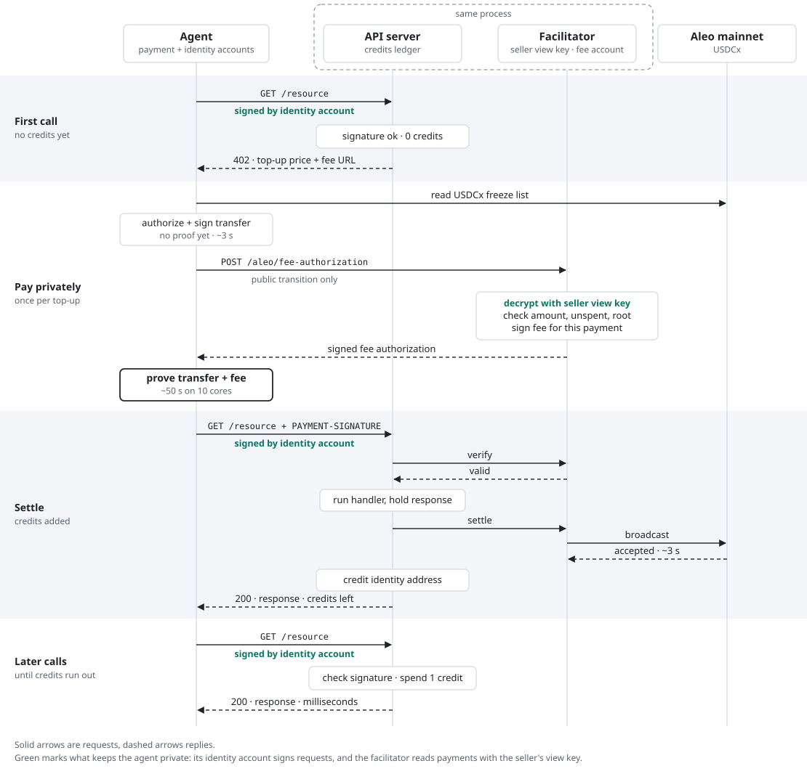

# x402 on Aleo

Private [x402](https://x402.org) payments for agent-to-agent APIs, paid in USDCx on Aleo mainnet. On-chain, the payer, the payee and the amount stay encrypted. Agents prepay for blocks of calls, so the minute of proving a private payment takes is spent once per top-up rather than once per call, and they prove which balance is theirs by signing requests with a per-service Aleo account that is kept apart from the wallet that pays.

> [!WARNING]
> Experimental and unaudited. This moves real funds on Aleo mainnet, has a known gap in fee sponsorship (see [known limits](examples/haiku/README.md#known-limits)), and keeps its state in memory and local files. Use small amounts, and don't run it in production as it is.

## How it works

<picture>
  <source media="(prefers-color-scheme: dark)" srcset="docs/payment-flow-dark.svg">
  
</picture>

An agent's first call has no credits, so it gets a 402. The agent signs a private USDCx transfer locally, sends only its public transition to the facilitator, which checks it with the seller's view key and signs the network fee, then proves the payment and retries. Once the payment settles on Aleo, the server credits the agent's identity address, and later calls spend those credits in milliseconds without touching the chain. The agent's payment account never leaves the agent.

## Packages

| Package | For | Main exports |
| --- | --- | --- |
| [`aleo-x402-buyer`](packages/aleo-x402-buyer) | Agents that pay | `ExactAleoClientScheme` (an x402 client scheme), `identityFor` / `withAgentIdentity` (signed requests), `withCredits` (bearer tokens), record helpers |
| [`aleo-x402-seller`](packages/aleo-x402-seller) | APIs that get paid | `ExactAleoServerScheme`, `ExactAleoFacilitatorScheme` (verifies payments with the seller's view key and sponsors network fees), `localFacilitatorClient`, `CreditsStore`, `verifyAgent` |
| [`aleo-x402-core`](packages/aleo-x402-core) | Both | Network and asset identifiers, Aleo API helpers, USDCx freeze-list proofs, the signed-request format |

They plug into the official x402 v2 SDK (`@x402/core`, `@x402/express`, `@x402/fetch`) and the Provable Aleo SDK.

### Seller

An API that charges $0.01 in private USDCx per request:

```ts
import http from "node:http";
import express from "express";
import { paymentMiddleware, x402ResourceServer } from "@x402/express";
import { ALEO_NETWORK } from "aleo-x402-core";
import { ExactAleoFacilitatorScheme, ExactAleoServerScheme, localFacilitatorClient } from "aleo-x402-seller";

const facilitator = new ExactAleoFacilitatorScheme({
  privateKey: process.env.ALEO_FACILITATOR_PRIVATE_KEY!, // pays each payment's network fee from its public ALEO balance
  sellerViewKey: process.env.ALEO_SELLER_VIEW_KEY!, // reads incoming private payments
  feeAuthorizationUrl: "https://api.example.com/aleo/fee-authorization",
  minAmount: 1_000n, // smallest payment, in micro-USDCx, worth sponsoring a fee for
});
const resourceServer = new x402ResourceServer(localFacilitatorClient(facilitator)).register(ALEO_NETWORK, new ExactAleoServerScheme());

const app = express();

// Buyers call this between signing and proving, to get their payment's network fee sponsored.
app.post("/aleo/fee-authorization", express.json({ limit: "1mb" }), async (req, res) => {
  try {
    res.json({ feeAuthorization: await facilitator.authorizeFee(req.body) });
  } catch (error) {
    res.status(400).json({ error: (error as Error).message });
  }
});

app.use(
  paymentMiddleware(
    { "GET /resource": { accepts: { scheme: "exact", price: "$0.01", network: ALEO_NETWORK, payTo: process.env.ALEO_SELLER_ADDRESS! } } },
    resourceServer,
  ),
);
app.get("/resource", (_req, res) => res.json({ ok: true }));

// A paid request carries a whole proven transaction (~14 KB) in a header, and buyers can go quiet
// for a minute while proving, so allow large headers and long-lived idle connections.
const server = http.createServer({ maxHeaderSize: 64 * 1024 }, app);
server.keepAliveTimeout = 120_000;
server.headersTimeout = 125_000;
server.listen(4021);
```

To sell prepaid credits instead of charging per request, add `CreditsStore` and `verifyAgent` as in [`examples/haiku/src/server.ts`](examples/haiku/src/server.ts).

### Buyer

```ts
import { Account, AleoKeyProvider, initThreadPool, LocalFileKeyStore, ProgramManager } from "@provablehq/sdk/mainnet.js";
import { wrapFetchWithPayment, x402Client } from "@x402/fetch";
import { API_HOST } from "aleo-x402-core";
import { ExactAleoClientScheme, identityFor, loadRecords, withAgentIdentity } from "aleo-x402-buyer";

await initThreadPool(); // prove on every core
const payment = new Account({ privateKey: process.env.ALEO_BUYER_PRIVATE_KEY! }); // holds the private USDCx
const keyProvider = new AleoKeyProvider();
keyProvider.useCache(true);
const programManager = new ProgramManager(API_HOST, keyProvider, undefined, undefined, new LocalFileKeyStore()); // caches proving keys in ./.aleo

const client = new x402Client().register("aleo:*", new ExactAleoClientScheme(payment, programManager, loadRecords()));
const identity = identityFor("api.example.com", ".agent-identity.json"); // one per service, holds no funds
const pay = wrapFetchWithPayment(withAgentIdentity(fetch, identity), client);

const response = await pay("https://api.example.com/resource"); // spends a credit, or pays a private top-up when they run out
```

After a top-up, save the buyer's change records as [`examples/haiku/src/aleo-client.ts`](examples/haiku/src/aleo-client.ts) does, so the next payment can spend them.

## Quickstart

[`examples/haiku`](examples/haiku) is an API that sells haikus for prepaid credits, payable privately in USDCx on Aleo mainnet (and optionally in public USDC on Base Sepolia). Running it end to end takes:

- Node.js 20.6 or later (tested on 23), and a multi-core machine: proving uses every core.
- About 400 MB of disk for proving keys, which are built or downloaded on first use.
- A little USDCx and about 1 ALEO on Aleo mainnet.

**1. Install and create wallets.** From the repository root:

```sh
npm install
npm run aleo:keygen    # Aleo buyer, seller and facilitator wallets
```

This writes to **`examples/haiku/.env`**, which is git-ignored. Every script reads its settings from that file.

**2. Fund the wallets.**

- **Buyer** (`ALEO_BUYER_ADDRESS`): send it USDCx as a **private** transfer. The client spends private records, not a public balance. You can get USDCx by bridging USDC through Circle's xReserve, or with a wallet that swaps into it, such as Shield.
- **Facilitator** (`ALEO_FACILITATOR_ADDRESS`): send it about 1 ALEO as a **public** balance. It pays a 0.0046 ALEO network fee per payment, so 1 ALEO covers about 200.

**3. Find the buyer's records.** `npm run aleo:records` scans recent blocks for the buyer's private records and saves them to `examples/haiku/.aleo-records.json`. By default it scans the last 2,000 blocks (about an hour and a half), so run it soon after funding, or pass a larger count, such as `npm run aleo:records -- 20000`. You only need it once: after each top-up the client saves its change records to that file, and a later scan would replace the file with only what it finds in its window.

**4. Run it.** A cheap package makes testing inexpensive:

```sh
TOPUP_PRICE='$0.01' CREDITS_PER_TOPUP=10 npm run server   # terminal 1
npm run aleo:client                                        # terminal 2: pays a private top-up, then 9 credits left
npm run aleo:client                                        # spends a credit
```

The first payment takes about a minute of proving, plus about 2 minutes once on a new machine to build the proving keys. To try everything except the broadcast, run `npm run server:dry-run` instead: it verifies payments but never sends them.

### Environment variables

| Variable | Used by | What it is |
| --- | --- | --- |
| `ALEO_BUYER_PRIVATE_KEY` | Client | The agent's payment account, which holds its private USDCx |
| `ALEO_SELLER_ADDRESS` | Server | Where payments go (`payTo`) |
| `ALEO_SELLER_VIEW_KEY` | Server | Decrypts incoming payments so the facilitator can verify them |
| `ALEO_FACILITATOR_PRIVATE_KEY` | Server | Pays network fees from its public ALEO balance |
| `ALEO_SELLER_PRIVATE_KEY` | Nothing | Spends the seller's earnings. The server doesn't need it |
| `ALEO_BUYER_ADDRESS`, `ALEO_FACILITATOR_ADDRESS` | Balance scripts | Addresses to fund and check |
| `BUYER_PRIVATE_KEY`, `BUYER_ADDRESS`, `SELLER_ADDRESS`, `SELLER_PRIVATE_KEY` | Base Sepolia option | Optional testnet wallets from `npm run keygen`. When `SELLER_ADDRESS` is set, the server offers Base Sepolia USDC too |

Optional settings, in `.env` or on the command line: `PORT` (default `4021`), `PUBLIC_URL` (the server's public address, used in the fee-authorization URL), `TOPUP_PRICE` (default `$1`), `CREDITS_PER_TOPUP` (default `1000`), `HAIKU_URL` (where the clients send requests) and `CREDITS_AUTH=token` (clients use a bearer token instead of signed requests).

> [!CAUTION]
> `.env` keeps every key in plain text. That's fine for trying this out with small amounts, but not for production:
> - Load keys from a secrets manager or KMS, not a file on disk, and never commit them.
> - The API server needs only the seller's address and view key, plus the facilitator key. Keep the seller's private key, which spends your earnings, off the server.
> - The facilitator key is a hot wallet. Keep only enough ALEO on it for fees, top it up regularly, and alert when it runs low.
> - The seller's view key reveals every payment the seller receives. Protect it as carefully as a private key.
> - On agents, the payment key spends funds and identity keys spend credits. Store them encrypted. `.aleo-records.json` holds the buyer's records in plain text.

The example's [README](examples/haiku/README.md) covers the credits protocol, timings and known limits.

## Status

Working on Aleo mainnet: private USDCx top-ups with facilitator-paid fees, prepaid credits, and signed agent identities. First live x402 payment: [at17qdjn…q2aq6l3](https://explorer.provable.com/transaction/at17qdjnsefncpp9rv8h4hp4n5h60ltksdrvxp28hn39yct8unq6q9q2aq6l3).

## License

[Apache-2.0](LICENSE). The packages depend on Provable's Aleo SDK (`@provablehq/sdk`), which is licensed separately under GPL-3.0.
